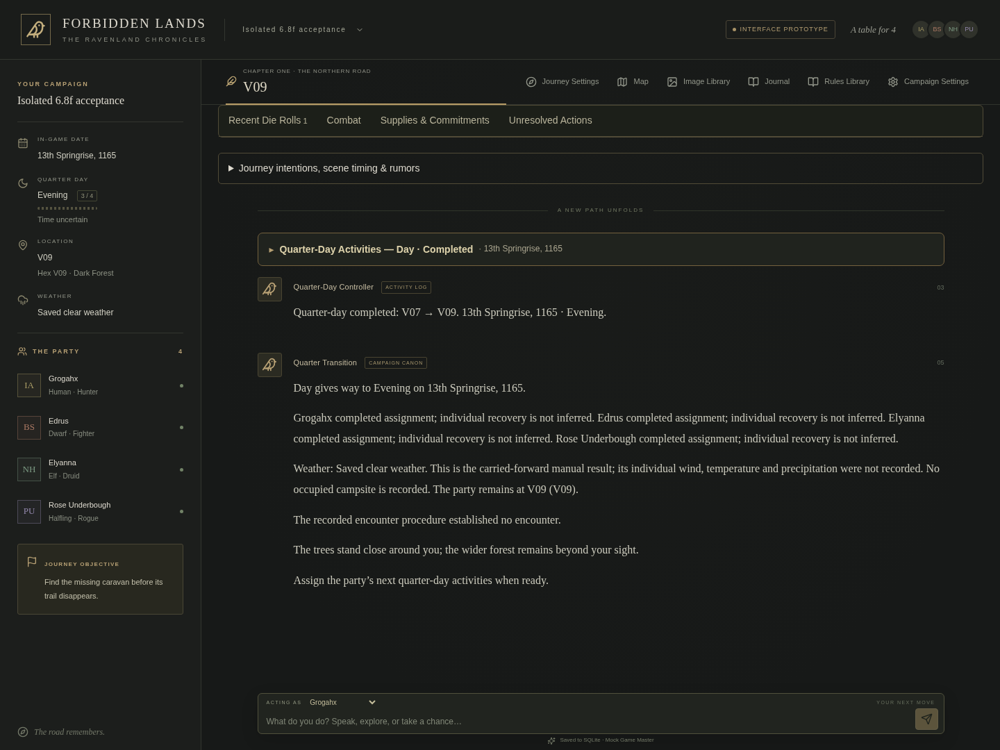
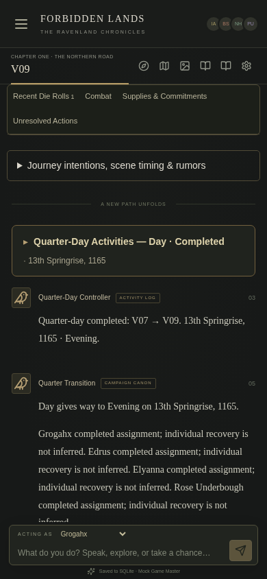

# Phase 6.8f — AI-orchestrated quarter-day resolution

This implementation adds an explicitly selected, deterministic coordinator to the existing Quarter-Day Activities menu. It uses the existing journey, dice, activity, calendar, weather, transition and combat services. It does not enable assistance, correct dates, activate weather, spend Willpower or alter the live Ravenland Mysteries campaign during installation.

## Using the new workflow

1. Open Quarter-Day Activities and select **AI GM Assisted quarter-day resolution**. Assign each character as before. Select the actual adjacent destination for travel.
2. Choose **Encounter Handling**: AI GM Assisted introduces the original Guide's encounter scene; Table GM Review saves the roll for review before introduction; Manual holds the unrolled check. Existing campaigns retain their previous behavior until this is selected deliberately.
3. Select automatic completion if desired. This authorizes completion of this submission when its required procedures are ready. It does not authorize a Push, Willpower spending, consumption, prey/equipment choices or combat actions. With it off, one Complete quarter-day button appears when ready.
4. Submit. Matching saved rolls are used automatically when uniquely eligible. Otherwise roll from the character sheet. Requested navigation and encounter-detection pools can be staged on the sheet. Multiple eligible cards require an explicit selection.
5. Answer the specific remaining decision in the same panel. Advanced Table GM Review retains the original controls for exceptional procedures. Native hunting, foraging and cooking choices remain available without a second routine completion control.

For an existing **pending** legacy entry, review its saved history and explicitly choose **Review and start assisted resolution**. Completed historical quarters cannot be adopted or replayed.

## Testing override procedure

An authenticated Table GM can say **“For testing purposes, skip this encounter and continue the story and quarter-day.”** The command targets the actual saved encounter for the current submitted quarter. It records **Skipped — Table GM Testing Override**, preserves the original D66, selected entry, scene, position and prior consequences, and resumes the same journey. It gives no victory, escape, rewards or restoration. Automatic completion still requires the original authorization and all normal blockers to be clear. The UI offers the same operation with a scoped reason and confirmation.

To skip a check **before** it is rolled, select Manual encounter handling and use **Waive this encounter check for testing**, or explicitly ask to waive that pending check for testing. This saves a waiver with null dice and null encounter selection. A rolled positive encounter must be skipped instead; it cannot be converted into no encounter. Stationary daily checks retain their same-day scope, including reviewed calendar label aliases. Future hiking quarters and later days retain their normal checks.

An active combat cannot be bypassed with these controls. Use the existing reviewed administrative combat recovery first, preserving damage, attacks, dice and unresolved obligations. Existing linked encounter reviews and mandatory consequences can still block continuation afterward.

## Required deliverables

1. **Excessive forms:** the assignment menu, legacy manual resolution, native activity panel and conversational journey controller previously supplied separate completion paths. Travel asked for an ending hex, weather and free-text adjudication even when those facts were already saved.
2. **Desynchronization:** conversational replies and manual outcome labels could describe progress without committing the corresponding journey/time service operation. A manually claimed Success also lacked a separate receipt explaining a raw failed roll.
3. **Coordinator:** an opt-in persisted flow runs bounded steps inside an immediate transaction. Each step uses a savepoint and the existing services. A failure rolls back that step and leaves a precise hold; earlier committed progress remains usable.
4. **Assignment menu:** retained. Assisted submissions may leave outcomes blank and roll afterward. The original DayTracker submission remains historical evidence.
5. **Saved rolls:** association checks character, skill, actual pool/modifier, time window, existing bindings and prior use. Route navigation is bound to the exact route step. Watch has its own typed detection request. Ambiguous cards require selection; none is rerolled automatically.
6. **Outcome model:** immutable original/result dice remain separate from `activityOutcomes`. Intervention receipts contain the raw and final successes, assignment/check scope, source, actor, reason, date/time and WP cost. Ordinary campaign edits cannot insert these receipts.
7. **Talents/WP:** source-verified Druid Path of the Forest can convert the current failed Lead the Way, Forage or Hunt-search result into one final success for exactly one explicitly authorized WP. It cannot fix a past entered hex or a hunting kill roll. Pathfinder is a different general talent: +1 navigation, rank 2 eligible uninterrupted Rest through the existing recovery adapter, and optional rank 3 D8. Recovery restrictions and actual pools remain enforced. Hosted owners may authorize their own intervention; party movement/time still requires the party controller.
8. **Encounter procedure:** original Handbook printed pp. 147–148 establishes hiking-quarter versus stationary-day frequency and the distinction between encounter occurrence and detection. Original Guide printed pp. 146–147 supplies the actual terrain-column D66 selection. No generic probability is substituted.
9. **Scene lifecycle:** pending → saved none, saved review, or actual scene → reviewed resolution or explicitly skipped. All 43 original Guide italic read-aloud passages are bounded against the authorized original PDF at runtime; their normalized hashes also match an independent extraction of the original italic text. Short extraction boundaries are stored in code; the book and full encounter bodies are not. Cross-page headers/watermarks and private GM explanations are excluded. Missing or changed evidence produces a specific review hold.
10. **Watch/detection:** failed Watch does not generate an encounter. A saved no-encounter check continues without demanding a fresh Watch roll. An actual scene requests Scouting when necessary; a failed eligible card retains its Push/keep decision before close detection is established. An explicitly introduced ambush requires its opposed procedure. No surprise attack, damage or initiative is invented.
11. **Interruption/resumption:** route receipts, the actual entered hex, the encounter check and the pending quarter survive restart. Skipping/resolving a scene resumes that entry, rather than creating a second journey or charging another quarter.
12. **Conversational testing skip:** implemented with authenticated Table GM identity, scoped durable receipts and unchanged original encounter evidence.
13. **Waiver distinction:** implemented only for an unrolled pending check. It never manufactures a zero/no-encounter roll.
14. **One-screen resolution:** shows the durable status, next decision, final outcome evidence, meaningful activity controls and authorized completion. Exceptional legacy forms remain collapsed in Advanced Table GM Review.
15. **Routine weather/consequence entry:** assisted completion reads the actual current hex and saved weather and derives its adjudication from verified receipts. It does not ask for arbitrary replacement weather or routine free-text consequences.
16. **Completion authorization:** remembered preferences accompany each explicit submission. Auto-completion off requires the panel's Complete action or “Finish this quarter-day.” Neither a model response nor a saved roll grants new resource/combat permissions.
17. **AI integration:** current resolution context is supplied to the existing AI service. Deterministic conversational continuation, completion and testing commands invoke real services. Structured `coordinate_quarter` provider actions can continue an already authorized flow through the existing action-confirmation endpoint; they cannot spend WP, Push, waive, skip or resolve scenes. The existing transition service supplies the completed scene once, with distinct no-encounter, waiver and skip wording. Provider failures do not undo committed mechanics.
18. **Transactions/idempotency:** campaign revisions, request fingerprints, stable route/entry/completion operation IDs, per-step savepoints and durable command receipts prevent duplicate movement, time, checks, intervention costs and narration. Dice saving precedes continuation. Hosted players who cannot coordinate the party can still save their own authorized decision for the controller to resume.
19. **Files/migration:** migration `028_quarter_orchestration.sql` adds flow, encounter-check and command-receipt tables with campaign cascade cleanup. New code lives in `src/server/quarter-resolution`, `src/lib/quarter-resolution.ts`, `/api/quarter-resolution` and `QuarterResolutionPanel`. Integration touches existing assignment, expedition, activity, dice, sheet bridge, AI and transition services. No sourcebook files or private database fixtures are committed.
20. **Original PDFs:** fifth-printing Handbook and Guide were indexed into isolated test databases with their original private visibility. Tests cover real navigation/frequency/table evidence, all 43 read-aloud boundaries, distinct talent rules and preservation of original dice. No paid AI calls are needed; the SDK integration uses a controlled response transport.
21. **General regressions:** results are listed in the validation section below.
22. **Focused tests:** source absence, authority, receipt injection rejection, V07→V09, WP once-only, Pathfinder ranks, Forage yield, all scene boundaries, hosted owner consent, Watch Push/keep, contradictory Success claims, restart, skip, waiver and SDK action dispatch.
23. **Browser acceptance:** desktop/mobile assignment → requested sheet navigation roll → automatic completion; hidden routine ending-hex/weather forms; saved weather; reload/restart; actual positive scene plus requested Watch roll; restart during that scene; explicit Table GM skip and completion of the original quarter. Screenshots show the isolated fixture.
24. **Exact reproduction:** 13th Springrise, 1165, Day; V07→V09, on foot, actual Dark Forest destination and one-hex allowance. Edrus's saved Survival success enters V09 once; a failed saved Watch plus actual Guide D66 no encounter does not interrupt travel. Completion advances to Evening once and retains established weather. One transition and one entry receipt remain after retries. A separate raw-zero/claimed-Success test holds without inventing a talent or spending WP.
25. **Live compatibility:** no live campaign data was edited. Existing manual workflows remain available; pending legacy entries require explicit adoption. Calendar, campsite, inventory, completed activity records, injury timelines, resource dice and combat history retain their existing authoritative services. This phase does not activate Ravenland Weather v2.0 or alter a Stillfall/Springrise label correction.
26. **Remaining manual procedures:** unsupported or ambiguous mounted/crossing/mixed-terrain routes, forced marches, explicit Hike checks, unresolved navigation mishaps, active ambushes, encounter-specific hidden facts/effects, NPC/combat choices, genuine prey/equipment/cooking decisions, daily needs and mandatory recovery retain their source-backed activity, Table GM or combat procedures. The new coordinator does not invent those decisions. The initial menu selects one adjacent destination; existing Advanced route controls support reviewed extensions. Path of the Forest before a roll, its higher-rank cold/needs abilities, and additional unimplemented talents are not newly automated.

## Validation

All checks below passed against the final implementation. No private PDFs, full source bodies, test databases or credentials are included in this report.

- `npm run test:retrieval-check`: **575 general regression tests and 289 original-PDF integration checks passed**.
- `node --import tsx --test tests/quarter-orchestration.test.ts tests/quarter-orchestration.integration.ts`: **15 focused tests passed**, including a real SDK structured-response/action-confirmation round trip with a controlled transport.
- `npm run test:calendar:real`: **2 additional original-PDF calendar/season/injury checks passed**. Calendar and injury unit tests also remain in the general suite.
- `npm run test:quarter-orchestration:browser`: **passed** with the actual PDFs, Chromium at 1440×1080 and 390×844, normal V07→V09 completion, requested navigation/Watch sheet rolls, saved weather, scene restart, Table GM skip and exactly-once completion.
- `npm run test:sheet-layout`: **passed**, including desktop/mobile layout, fields, resource dice, coins, gear/talents, encumbrance, dated injuries, countdowns, reload and restart.
- `npm run typecheck`, `npm run build` and `git diff --check`: **passed**.

The existing [reviewed calendar correction and weather activation procedure](phase6-8e-unified-calendar.md) remains the way to correct Stillfall → Springrise and activate Ravenland Weather v2.0 afterward. Selecting assisted resolution does neither automatically.

