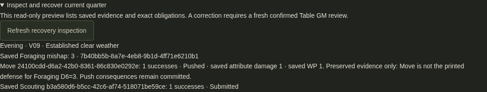
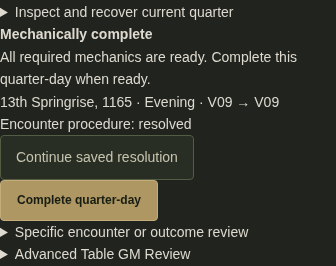

# Phase 6.8f.1 — Stationary completion and encounter handoff

The supplied V09 Evening scenario is reproduced in an isolated campaign. The live campaign database is not present in this workspace and was not opened or changed. The application now provides an authenticated Table GM inspection and reviewed correction operation for the actual saved campaign when this code is installed.

## Exact causes

- `quarterConversation` required an existing assisted flow and accepted only a narrow, anchored “finish/complete this/the quarter-day” phrase. Other finish commands fell through to the conversational journey controller, which has no active journey for a stationary camp quarter. Legacy stationary quarters now use their existing native completion service; assisted quarters use their persisted coordinator. No new encounter is manufactured while finishing an older manual quarter.
- The Encounter Director saved an introduced scene, but “Avoid” had no corresponding legal operation. AI prose could describe avoidance without changing that scene. An explicit source-supported contact-declination operation now commits the outcome before narrating it. Bare “Avoid” asks which procedure is intended.
- The director rejected every card with `activityContext`, including an actual saved and already-submitted native Keep Watch result. The common Watch evidence adapter now recognizes that exact entry/assignment/step binding, alongside the existing quarter-scoped roll. It does not reuse other quarters' cards or reinterpret raw failures as successes. A typed card retains its original validated pool even if a Push changed current attributes.
- Foraging result 3 used the generic printed-follow-up hold. Subsequent snake/Move narration had no source-backed operation connecting that roll to resolution. The result now names its actual mandatory correction and cannot be cleared by a successful Move card or by prose.
- Assisted completion uses a stable service receipt, which is not necessarily the chat request ID. The AI response previously could fail to recognize the newly committed transition. Reply/retry delivery now follows the saved coordinator receipt to the same transition and reuses that scene rather than appending another Night narrative.
- Recovery previews could be replaced by out-of-order reads or become stale solely because chat was appended. The panel sequences reads and rechecks the reviewed mechanical snapshot before applying a correction. Genuine mechanical changes require a refreshed review; ordinary chat does not change the same mechanical preview. Campaign revision and Table GM authorization are still checked inside the transaction. Visible panels also refresh from read-only status checks and focus changes, propagating newer campaign revisions through the existing refresh event. A saved result from a separate character-sheet window therefore updates the completion controls without performing another roll or mechanical action.

## Original-PDF finding

The original fifth-printing **Player's Handbook, printed p. 150**, lists **Foraging D6 = 3 as Sprained Ankle**, equivalent to **blunt-force critical result 25–26**. The table on **printed p. 197** calls that equivalent row Broken Toes: nonlethal, **RUN becomes a slow action during healing**, healing time **D6**. The healing section on **printed p. 109** establishes that those times are measured in days.

There is no printed snake encounter or defensive Move/Dodge save for this result. The saved pushed Move remains historical evidence. Its already committed attribute damage, Willpower and gear effects are retained, not refunded, reapplied or treated as an injury save. The correction creates or explicitly links the fixed source-backed injury; it never rolls a replacement critical D66 or grants food, a cure or recovery. Its dated record uses the existing campaign injury timeline. The existing critical-injury/combat review remains responsible for enforcing applicable action restrictions.

The original **Gamemaster's Guide, printed pp. 146 and 149**, distinguishes successful detection at a safe distance from surprise/close contact and describes encounter 3, **The Orcish Fugitive**, as a procession returning to its clan. For this unchanged distant scene, the party can explicitly decline contact and let it pass at the current position. That is recorded as `declined_contact`, **not escape from pursuit or combat**. Merely saying “Avoid” is insufficient to choose between that decision and leaving camp to Sneak away. Close detection, modified/hostile scenes, ambushes, combat history and applicable encounter house rules require their actual procedure or reviewed Table GM outcome.

## Safely recover the actual V09 Evening

1. Update/restart the application with this commit. Open the existing submitted **Evening** quarter at **V09**; do not create another activity submission or adjust its clock.
2. As the authenticated Table GM, open **Inspect and recover current quarter**, then refresh the inspection. It lists the saved Foraging D6, the pushed Move and its committed effects, Scouting cards, actual encounter state, each activity's state and remaining mandatory obligations. An ordinary player or a role claim in chat cannot authorize the correction.
3. If this is a legacy submission without an assisted flow, explicitly review and start assistance for that existing entry first. Saved same-day encounter checks are reused. Do not reroll a known check. Older unassisted native completion also retains its existing manual receipt path, while any actually saved unresolved director encounter still blocks it.
4. For a verified bound Foraging result 3, choose **Review sprained-ankle correction**. Record why the snake/Move interpretation was unsupported. Link an existing active injury if it already records the actual result and duration, avoiding duplication; otherwise confirm the source-backed fixed injury. The original review, summary, pending request and dice remain in the correction audit/history.
5. If its healing duration is not already established, roll the newly requested **forage-injury-duration D6** from Grogahx's sheet. This establishes the printed healing time; it does not reroll the mishap or Move result. A previously established injury duration should be preserved through the reviewed existing-injury link.
6. Resolve the actual orc scene. If it is the unchanged original procession and Rose's saved successful Scouting establishes safe-distance detection, say **“Avoid”**, then **“Let them pass without contact”** when asked. The panel also offers the supported contact-declination action. If the inspection establishes a different or modified scene, failed/ambiguous detection or an actual attack, resolve its specific procedure instead. AI prose alone never closes it.
7. A deliberate **“For testing purposes, skip this encounter and continue the story and quarter-day.”** remains available to the authenticated Table GM. It preserves the original encounter dice and records a testing skip, not avoidance, victory or escape. It cannot bypass active combat recovery or the Foraging injury obligation.
8. Resolve any remaining camp, Sleep, activity, daily-needs or mandatory consequence requirements identified by the inspection. Then say **“Return to camp and complete the Evening quarter-day.”** “Complete the Quarter Day,” “Finish Evening,” “Advance to Night,” and “Close the current quarter” route to the same actual quarter. Commands cannot skip additional quarters or complete a different named period.
9. Verify **Night at V09**, the established campsite and weather, one authoritative Night transition and the next Night activity draft. Existing dice and Push consequences remain saved. Retrying the same request or restarting cannot charge another quarter or append another transition.

The correction is a specific reviewed operation, not another general-purpose quarter completion form. No ending-hex selection, replacement weather text or narrative summary is needed. Historical erroneous prose remains preserved as evidence; current receipts and the authoritative clock take precedence.

## Narration and timing

Both streamed and persisted provider responses are checked against the actual pending quarter and encounter. A blocked quarter cannot be described as Night beginning, an unresolved encounter as avoided, or this sprain as a successfully dodged snake. The response identifies the actual outstanding requirement and supported recovery action. Source-supported contact declination is distinguished from a combat escape.

Assisted stationary encounter checks still run at the coordinator's early procedural stage, before the activity quarter can complete. The existing once-per-stationary-day scope, reviewed calendar aliases and saved dice are retained. Completion checks never silently turn an old AI statement into no encounter or introduce an invented replacement roll. No migration or automatic live repair is performed.

## Validation

All verification below passed. PDF and browser fixtures are temporary, retain the original private source visibility, and use controlled provider responses. No paid AI dependency, private PDF, full source-body log or campaign database is committed. Screenshots capture the recovery controls rather than the book’s encounter read-aloud.

- **Required full regression:** `npm run test:retrieval-check` — **577 general tests and 289 original-PDF checks passed**.
- **Focused orchestration:** Phase 6.8f plus Phase 6.8f.1 — **21 tests passed**.
- **Native/Morning compatibility:** the direct original-PDF activity and Morning-transition run plus Phase 6.8f.1 — **59 tests passed** (overlaps the suites above).
- **Browser:** `npm run test:stationary-quarter:browser` — **passed** at desktop and mobile sizes, with a controlled SDK transport and restart.
- **Build:** TypeScript, production build and `git diff --check` — **passed**.

- Focused Phase 6.8f and 6.8f.1 tests cover the supplied stationary sequence, legal/blocked routing, native Scouting, source correction, ordinary-player rejection, stale mechanical previews, Push preservation, deliberate avoidance, canonical transition delivery and retries.
- Existing native activity and Morning-transition PDF regressions are retained, including legacy stationary completion.
- Browser acceptance covers the actual original PDFs, a controlled SDK transport deliberately returning false completion/avoidance claims, reviewed recovery controls, the requested sheet duration roll, one Evening-to-Night scene, desktop/mobile rendering and restart.

